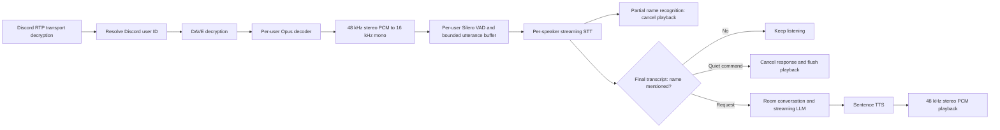

# Murbot: Discord conversation bot

Murbot listens to each participant separately and answers utterances containing its configured name. Local Docker services and compatible hosted APIs can be mixed independently.



Setup:

1. Install Python 3.11+, uv, and Discord voice dependencies. Enable Message Content intent for prefix commands; grant Connect, Speak, View Channel, and Send Messages.
2. Copy `.env.example` to `.env` and set `DISCORD_TOKEN`.
3. Start optional local services: `docker compose up -d ollama kokoro-tts`.
4. Download the LLM once: `docker compose exec ollama ollama pull qwen2.5:3b`.
5. Start the bot: `uv run discord-voice-bot`.

A local configuration:

```dotenv
BOT_NAME=murbot
BOT_ALIASES=mur bot
MODE=local
LLM_PROVIDER=local
LOCAL_LLM_BASE_URL=http://localhost:11434/v1
LOCAL_LLM_MODEL=qwen2.5:3b
STT_PROVIDER=local
LOCAL_WHISPER_MODEL=large-v3-turbo
LOCAL_WHISPER_DEVICE=cuda
LOCAL_WHISPER_COMPUTE=float16
STT_LANGUAGE=pt
VAD_THRESHOLD=0.5
INTERRUPTION_FRAMES_THRESHOLD=2
SILENCE_DURATION_MS=750
TTS_PROVIDER=kokoro
LOCAL_TTS_BASE_URL=http://localhost:8880/v1
KOKORO_VOICE=pf_dora
```

`MODE` selects the LLM endpoint. It does not override STT or TTS. For an API LLM, set `MODE=cloud`, `LLM_PROVIDER=cloud`, `OPENAI_BASE_URL`, `OPENAI_API_KEY`, and `LLM_MODEL`. Despite their legacy names, these settings can target compatible providers. Set `LLM_TOOLS_ENABLED=false` if a model does not support tool calls.

For API STT, set `STT_PROVIDER=cloud`, `STT_BASE_URL`, `STT_API_KEY`, and `CLOUD_WHISPER_MODEL`. A local Docker server exposing `/v1/audio/transcriptions` works through the same API adapter. Use `STT_LANGUAGE=auto` for language detection. API STT uses WAV uploads; it does not currently apply local Whisper's segment-confidence filter.

For API TTS, set `TTS_PROVIDER=openai`, `TTS_BASE_URL`, `TTS_API_KEY`, `TTS_MODEL`, and `API_TTS_VOICE`. This endpoint is independent of the LLM endpoint, so choosing Groq for text does not send TTS requests to Groq. `TTS_PROVIDER=edge` is also supported. Kokoro falls back to Edge on errors, which sends text over the internet.

STT defaults to in-process faster-whisper, not a Docker STT service. Docker Compose includes Ollama, Kokoro, and an optional bot container. GPU use requires working host/container drivers and enough VRAM for all models. The Python image may need additional CUDA runtime configuration for GPU Whisper; CPU int8 fallback is available.

| Command | Behavior |
| --- | --- |
| `!join` / `!entrar` | Join your voice room silently and listen. |
| `!leave` / `!sair` | Stop the room session and disconnect. |
| `!clear` / `!limpar` | Cancel the current response and clear this room's history. |
| `!mode local` / `!mode cloud` | Change the global LLM configuration and rebuild room engines. STT/TTS remain independent. |
| `!tts kokoro` / `edge` / `openai` / `elevenlabs` | Change TTS globally. |
| `!voice dora` / `alex` / `santa` | Select a Kokoro voice. Edge voices include `francisca` and `antonio`. |
| `!status` | Show active configuration. |

Say the name to start or take over a conversation:

- "Murbot, me explica o que é uma estrela."
- "Murbot, fica quieto." / "Murbot, pare de falar." / "Murbot, be quiet."
- "Murbot, agora fala sobre planetas."

The active/default configuration uses semantic follow-ups: `CONVERSATION_SEMANTIC_FOLLOWUPS=true` and `CONVERSATION_FOLLOWUP_SECONDS=20`. The last addressed speaker can ask a follow-up without repeating the name during the reply and for 20 seconds after playback ends. A separate tool-free LLM check accepts only clear requests directed at Murbot; comments, acknowledgments, side conversations (even about the same topic), and uncertain intent leave playback running. Unnamed partial transcripts never interrupt: intent is assessed after the utterance ends. The check has a three-second timeout and ignores the turn on error. Another speaker must first address Murbot by name. Intent classification is probabilistic and may make mistakes.

Say “para, Murbot” to cancel speech/generation silently and “continua, Murbot” to resume an interrupted task using retained context. You do not need to say “continua” to keep the bot speaking: unrelated conversation simply leaves it playing. Resuming generates a continuation rather than unpausing an exact audio position. Set the follow-up duration to zero for strict name-only routing. Disabling semantic follow-ups with a positive duration restores the less selective legacy timing heuristic. Explicit name/stop recognition bypasses the semantic check, which runs outside the routing lock. Room history contains speaker IDs and names. Streaming is enabled by default for local Whisper, using rolling re-decodes; recognition still has decoding latency. Native Deepgram WebSocket streaming is also available; REST upload providers remain final-only. Literal name matching still cannot reliably distinguish discussing the bot from addressing it when its name is explicitly spoken.

Validation:

```powershell
uv run python -m unittest discover -s tests -v
uv run python scripts/diagnose_audio.py --synthesize
uv run python scripts/diagnose_llm.py
uv run python scripts/diagnose_streaming.py
uv build
```

The audio diagnostic sends a neutral known phrase to the configured Kokoro endpoint and transcribes it with configured STT; it does not connect to Discord. The LLM diagnostic is restricted to the local configuration.

For a problematic Discord clip, temporarily set `DEBUG_AUDIO_DIR=data/debug_audio`, restart, speak, then inspect the captured 16 kHz WAV. Run `uv run python scripts/diagnose_audio.py --wav data/debug_audio/<clip>.wav` to replay it through STT. Disable capture and delete the files after debugging. Capture files are not automatically rotated. Do not share tokens or private recordings.

See [ARCHITECTURE_REVIEW.md](ARCHITECTURE_REVIEW.md) for findings, changes, evidence, and remaining limitations.

See [STREAMING_STT.md](STREAMING_STT.md) for streaming configuration, provider differences, and measured local latency.

Runtime logs are saved to `logs/murbot.log`, including DEBUG details from the bot and Python dependencies, recognized speech, routing, tool calls, completed LLM replies, warnings, and error tracebacks. INFO and higher also appear in the console. File writes run on a separate logging thread so disk rotation does not block voice processing. Credentials from environment variables and common authentication fields are redacted. Logs contain conversation text; raw audio capture remains a separate opt-in feature.

Routine voice-receive RTCP type-200 sender-report notices stay in file logs but are filtered from console output. Other reception messages and warnings are preserved in the console.

The active file rotates at 10 MiB into `murbot.log.1` through `murbot.log.10`; oldest backups are removed (approximately 110 MiB total). Configure `LOG_DIR`, `LOG_LEVEL`, `LOG_CONSOLE_LEVEL`, `LOG_MAX_BYTES`, and `LOG_BACKUP_COUNT` in `.env`. `STT_LOG_TRANSCRIPTS=true` is enabled; set it to false to omit recognized speech. Logs append across restarts, flush on normal shutdown, and are excluded from Git and Docker build context.

Docker services also use rotating container logs (`json-file`, 10 MB × 10 files per service), covering their stdout/stderr. The optional bot container mounts `./logs:/app/logs` for persistent application logs. Apply Compose logging changes when recreating containers with `docker compose up -d --force-recreate`; running containers keep their existing log settings until recreated. Restart a locally running bot to activate its new logging and retrieval behavior.

Web search, public-page reading, room membership/status, recent speakers, and visible server channels are available through model tool calls. See [TOOLS.md](TOOLS.md) for spoken examples and verification.

ElevenLabs HTTP streaming TTS is now implemented; see [ELEVENLABS_TTS.md](ELEVENLABS_TTS.md) for the configured Brazilian voice and measured API test. [API_LLM_OPTIONS.md](API_LLM_OPTIONS.md) lists current budget LLM candidates and pricing. [TOOLS.md](TOOLS.md) separates the 14 callable tools from proposed additions.
